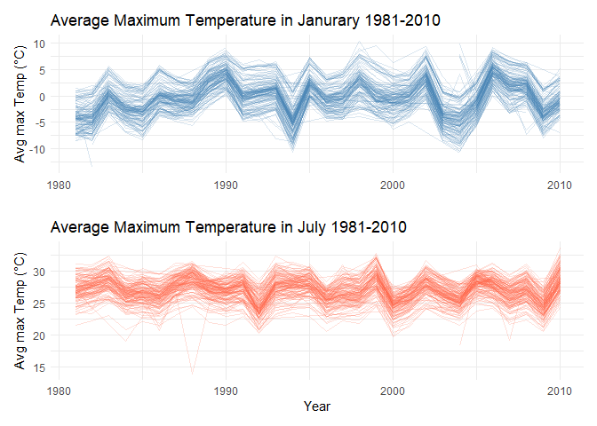
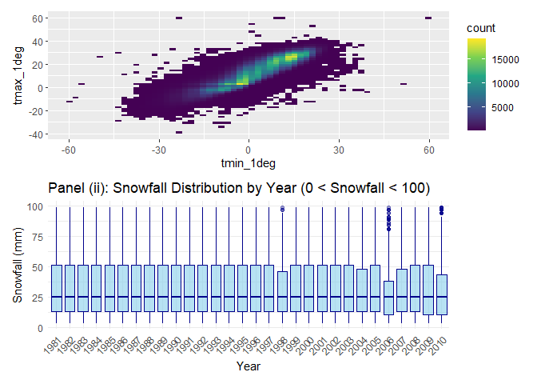
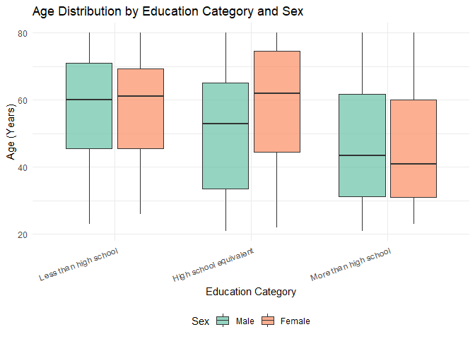

p8105_hw3_al4922
================
2026-10-19

### Problem 1

\##OH questions: 1. Do we get rid of NA’s? 2. guidance on indicating the
extent to which missing data is issue - key points to look at/mention?
3. what does ‘reasonable units’ mean, do the 3 variables have to be
converted to imperial? 4. what is ‘structure’ asking for 5. why is
scatterplot not the best option?6. When we look at 0-100 for snowfall,
is it by the original or is it by new variables we created

**Step 1: import and clean data**

``` r
data("ny_noaa") #load dataset into environment

noaa_df <- ny_noaa #assign into df, no need to convert missing values to NA since it's 'pre-built' into file

noaa_df = janitor::clean_names(noaa_df)

print(noaa_df, n = 20) #shows that column names converted correctly and that first 16 rows contains no data
```

    ## # A tibble: 2,595,176 × 7
    ##    id          date        prcp  snow  snwd tmax  tmin 
    ##    <chr>       <date>     <int> <int> <int> <chr> <chr>
    ##  1 US1NYAB0001 2007-11-01    NA    NA    NA <NA>  <NA> 
    ##  2 US1NYAB0001 2007-11-02    NA    NA    NA <NA>  <NA> 
    ##  3 US1NYAB0001 2007-11-03    NA    NA    NA <NA>  <NA> 
    ##  4 US1NYAB0001 2007-11-04    NA    NA    NA <NA>  <NA> 
    ##  5 US1NYAB0001 2007-11-05    NA    NA    NA <NA>  <NA> 
    ##  6 US1NYAB0001 2007-11-06    NA    NA    NA <NA>  <NA> 
    ##  7 US1NYAB0001 2007-11-07    NA    NA    NA <NA>  <NA> 
    ##  8 US1NYAB0001 2007-11-08    NA    NA    NA <NA>  <NA> 
    ##  9 US1NYAB0001 2007-11-09    NA    NA    NA <NA>  <NA> 
    ## 10 US1NYAB0001 2007-11-10    NA    NA    NA <NA>  <NA> 
    ## 11 US1NYAB0001 2007-11-11    NA    NA    NA <NA>  <NA> 
    ## 12 US1NYAB0001 2007-11-12    NA    NA    NA <NA>  <NA> 
    ## 13 US1NYAB0001 2007-11-13    NA    NA    NA <NA>  <NA> 
    ## 14 US1NYAB0001 2007-11-14    NA    NA    NA <NA>  <NA> 
    ## 15 US1NYAB0001 2007-11-15    NA    NA    NA <NA>  <NA> 
    ## 16 US1NYAB0001 2007-11-16    NA    NA    NA <NA>  <NA> 
    ## 17 US1NYAB0001 2007-11-17     3     3     0 <NA>  <NA> 
    ## 18 US1NYAB0001 2007-11-18     0     0    NA <NA>  <NA> 
    ## 19 US1NYAB0001 2007-11-19     0     0     0 <NA>  <NA> 
    ## 20 US1NYAB0001 2007-11-20    25     0     0 <NA>  <NA> 
    ## # ℹ 2,595,156 more rows

**Preliminary Data description:** This dataset contains 7 variables
named: “id”, “date”, “prcp”, “snow”, “snwd”, “tmax” and “tmin”. In these
7 columns, it contains 2595176 observations with its weather station ID
(“id”), date of observation (“date”), precipitation to tenths of mm
(“prcp”), snowfall to mm (“snow”), snow depth to mm (“snwd”), and min
max temperature to tenths of Celsius (“tmin”, “tmax”). The extent to
which missing data is an issue depends on what questions you want to
answer as well as if the data missing can be inferred from other data in
the same row. For example if you want to ask about precipitation levels
for a certain time period in which the column ‘prcp’ is empty, then that
would be a major issue. However, variables like ‘snwd’ could probably be
inferred from ‘snow’. Especially with 2595176 amount of entries even if
you can’t directly calculate ‘snwd’ given ‘snow’, you can just look at
other entries with the same ‘snow’ value and copy it in. These are just
two examples to show that missing data can be a very big issue or a
relatively smaller one depending on your question and specific
circumstances.

**Step 2: Data Manipulation**

``` r
noaa_df <- ny_noaa %>% #This creates separate variables for year, month and day and converts observations of temperature, precipitation and snowfall into more convenient scales (from mm or tenths of mm to cm and from tenths of degrees celsius to degrees celsius) 
  mutate(year = year(date),
         month = month(date),
         day = day(date),
         tmax_1deg = as.numeric(tmax)/10, #1C = 10 tengths of degrees celsius
         tmin_1deg = as.numeric(tmin)/10, #1C = 10 tengths of degrees celsius
         prcp_cm = prcp/100, #1 cm = 100 tenths of mm
         snow_cm = snow/10, #1 cm = 10 mm
         snwd_cm = snwd/10) #1 cm = 10 mm

print(n = 20, noaa_df, width = Inf)#Checked to see that new columns (variables) made correctly. 
```

    ## # A tibble: 2,595,176 × 15
    ##    id          date        prcp  snow  snwd tmax  tmin   year month   day
    ##    <chr>       <date>     <int> <int> <int> <chr> <chr> <dbl> <dbl> <int>
    ##  1 US1NYAB0001 2007-11-01    NA    NA    NA <NA>  <NA>   2007    11     1
    ##  2 US1NYAB0001 2007-11-02    NA    NA    NA <NA>  <NA>   2007    11     2
    ##  3 US1NYAB0001 2007-11-03    NA    NA    NA <NA>  <NA>   2007    11     3
    ##  4 US1NYAB0001 2007-11-04    NA    NA    NA <NA>  <NA>   2007    11     4
    ##  5 US1NYAB0001 2007-11-05    NA    NA    NA <NA>  <NA>   2007    11     5
    ##  6 US1NYAB0001 2007-11-06    NA    NA    NA <NA>  <NA>   2007    11     6
    ##  7 US1NYAB0001 2007-11-07    NA    NA    NA <NA>  <NA>   2007    11     7
    ##  8 US1NYAB0001 2007-11-08    NA    NA    NA <NA>  <NA>   2007    11     8
    ##  9 US1NYAB0001 2007-11-09    NA    NA    NA <NA>  <NA>   2007    11     9
    ## 10 US1NYAB0001 2007-11-10    NA    NA    NA <NA>  <NA>   2007    11    10
    ## 11 US1NYAB0001 2007-11-11    NA    NA    NA <NA>  <NA>   2007    11    11
    ## 12 US1NYAB0001 2007-11-12    NA    NA    NA <NA>  <NA>   2007    11    12
    ## 13 US1NYAB0001 2007-11-13    NA    NA    NA <NA>  <NA>   2007    11    13
    ## 14 US1NYAB0001 2007-11-14    NA    NA    NA <NA>  <NA>   2007    11    14
    ## 15 US1NYAB0001 2007-11-15    NA    NA    NA <NA>  <NA>   2007    11    15
    ## 16 US1NYAB0001 2007-11-16    NA    NA    NA <NA>  <NA>   2007    11    16
    ## 17 US1NYAB0001 2007-11-17     3     3     0 <NA>  <NA>   2007    11    17
    ## 18 US1NYAB0001 2007-11-18     0     0    NA <NA>  <NA>   2007    11    18
    ## 19 US1NYAB0001 2007-11-19     0     0     0 <NA>  <NA>   2007    11    19
    ## 20 US1NYAB0001 2007-11-20    25     0     0 <NA>  <NA>   2007    11    20
    ##    tmax_1deg tmin_1deg prcp_cm snow_cm snwd_cm
    ##        <dbl>     <dbl>   <dbl>   <dbl>   <dbl>
    ##  1        NA        NA   NA       NA        NA
    ##  2        NA        NA   NA       NA        NA
    ##  3        NA        NA   NA       NA        NA
    ##  4        NA        NA   NA       NA        NA
    ##  5        NA        NA   NA       NA        NA
    ##  6        NA        NA   NA       NA        NA
    ##  7        NA        NA   NA       NA        NA
    ##  8        NA        NA   NA       NA        NA
    ##  9        NA        NA   NA       NA        NA
    ## 10        NA        NA   NA       NA        NA
    ## 11        NA        NA   NA       NA        NA
    ## 12        NA        NA   NA       NA        NA
    ## 13        NA        NA   NA       NA        NA
    ## 14        NA        NA   NA       NA        NA
    ## 15        NA        NA   NA       NA        NA
    ## 16        NA        NA   NA       NA        NA
    ## 17        NA        NA    0.03     0.3       0
    ## 18        NA        NA    0        0        NA
    ## 19        NA        NA    0        0         0
    ## 20        NA        NA    0.25     0         0
    ## # ℹ 2,595,156 more rows

``` r
mc_snow <- noaa_df %>%
  count(snow_cm) %>%
  slice_max(n, n = 1) 

mc_snwd <- noaa_df %>%
  count(snwd_cm) %>%
  slice_max(n, n = 1)# shows results in tibble, most common value for both is '0' and shows up 1597641 times. 

mc_snowil <- mc_snow %>%
  pull(snow_cm)

mc_snwdil <- mc_snwd %>%
  pull(snwd_cm)
```

**Comment:** For snowfall, the most common values for “snow_cm” and
“snwd_cm” are 0 and 0 respectively. This is because in New York where
the weather data is being collected, most days out of the year don’t
snow.

**Step 3: Data Visualization**

``` r
#January plot: 
jan_noaa <- noaa_df %>%
  filter(month == 1) %>%
  group_by(id, year) %>%
  summarize(mean_tmax = mean(tmax_1deg, na.rm = TRUE), .groups = "drop") %>%
  ggplot(aes(x = year, y = mean_tmax, group = id)) +
  geom_line(alpha = 0.2, colour = "steelblue") +
  labs(
    title = "Average Maximum Temperature in Janurary 1981-2010",
    x ="", 
    y = "Avg max Temp (°C)"
    ) +
    theme_minimal()
#July plot: 
july_noaa <- noaa_df %>%
filter(month == 7) %>%
  group_by(id, year) %>%
  summarize(mean_tmax = mean(tmax_1deg, na.rm = TRUE), .groups = "drop") %>%
  ggplot(aes(x = year, y = mean_tmax, group = id)) +
  geom_line(alpha = 0.2, color = "tomato") +
  labs(
    title = "Average Maximum Temperature in July 1981-2010",
    x = "Year",
    y = "Avg max Temp (°C)"
  ) +
  theme_minimal()

# 3. Combine using patchwork operators
jan_noaa / july_noaa
```

    ## Warning: Removed 2905 rows containing missing values or values outside the scale range
    ## (`geom_line()`).

    ## Warning: Removed 3027 rows containing missing values or values outside the scale range
    ## (`geom_line()`).

<!-- -->
There doesn’t seem to be any trend with temperatures within the same
ranges (about -5 to 10C for Jan and 20-30C for July) across the period
observed (1981-2010). However, the stations generally trend up and down
‘together’ and so we see bold thick lines going up and down together.
However, outliers do exist trending at times opposite to the majority
instead of just trending ‘too much’ in the direction of the majority.
Examples include the two large downward spikes between 1980-1990 in the
“July” plot and a few peaks upwards between 2000-2005 in the “January”
plot.

**Step 3 cont: Data Visualization**

``` r
p1 <- noaa_df %>%
  ggplot(aes(x = tmin_1deg, y = tmax_1deg)) +
  geom_bin2d(bins = 60) +
  scale_fill_viridis_c(option = "viridis")
  labs(
    title = "Panel (i): Maximum vs. Minimum Temperature",
    x = "Min Temperature (°C)",
    y = "Max Temperature (°C)",
    fill = "Count"
  ) +
  theme_minimal()
```

    ## NULL

``` r
p2 <- noaa_df %>%
  filter(snow > 0 & snow < 100) %>%
  ggplot(aes(x = factor(year), y = snow)) +
  geom_boxplot(fill = "skyblue", color = "darkblue", alpha = 0.6, outlier.alpha = 0.1) +
  labs(
    title = "Panel (ii): Snowfall Distribution by Year (0 < Snowfall < 100)",
    x = "Year",
    y = "Snowfall (mm)"
  ) +
  theme_minimal() +
  theme(
    axis.text.x = element_text(angle = 45, hjust = 1) # Tilt year labels for readability
  )

# Combine them vertically using patchwork
p1 / p2
```

    ## Warning: Removed 1136276 rows containing non-finite outside the scale range
    ## (`stat_bin2d()`).

<!-- --> \### Problem 2
**Step 1: Load, tidy and merge**

``` r
acc_df <- read_csv(file = "./data/nhanes_accel.csv",
                   na = c("", "NA", "."))|>
          janitor::clean_names()
```

    ## Rows: 250 Columns: 1441
    ## ── Column specification ────────────────────────────────────────────────────────
    ## Delimiter: ","
    ## dbl (1441): SEQN, min1, min2, min3, min4, min5, min6, min7, min8, min9, min1...
    ## 
    ## ℹ Use `spec()` to retrieve the full column specification for this data.
    ## ℹ Specify the column types or set `show_col_types = FALSE` to quiet this message.

``` r
demo_df <- read_csv(file = "./data/nhanes_covar.csv",
                    skip = 4,
                    na = c("", "NA", "."))|>
          janitor::clean_names() |>
          drop_na() |>
          filter(age >= 21)
```

    ## Rows: 250 Columns: 5
    ## ── Column specification ────────────────────────────────────────────────────────
    ## Delimiter: ","
    ## dbl (5): SEQN, sex, age, BMI, education
    ## 
    ## ℹ Use `spec()` to retrieve the full column specification for this data.
    ## ℹ Specify the column types or set `show_col_types = FALSE` to quiet this message.

``` r
print(acc_df)
```

    ## # A tibble: 250 × 1,441
    ##     seqn  min1  min2  min3  min4   min5   min6  min7   min8    min9  min10
    ##    <dbl> <dbl> <dbl> <dbl> <dbl>  <dbl>  <dbl> <dbl>  <dbl>   <dbl>  <dbl>
    ##  1 62161 1.11  3.12  1.47  0.938 1.60   0.145  2.10  0.509   1.63   1.20  
    ##  2 62164 1.92  1.67  2.38  0.935 2.59   5.22   2.39  4.90    1.97   3.13  
    ##  3 62169 5.85  5.18  4.76  6.48  6.85   7.24   6.12  7.48    5.47   6.49  
    ##  4 62174 5.42  3.48  3.72  3.81  6.85   4.45   0.561 1.61    0.698  2.72  
    ##  5 62177 6.14  8.06  9.99  6.60  4.57   2.78   7.10  7.25   10.1    7.49  
    ##  6 62178 0.167 0.429 0.131 1.20  0.0796 0.0487 0.106 0.0653  0.0564 0.0639
    ##  7 62180 0.039 0     0     0     0.369  0.265  0.506 0.638   0      0.011 
    ##  8 62184 1.55  2.81  3.86  4.76  6.10   7.61   4.74  6.73    5.42   4.24  
    ##  9 62186 3.08  2.54  2.63  2.12  1.14   1.68   2.84  2.72    2.13   2.18  
    ## 10 62189 2.81  0.195 0.163 0     0.144  0.180  0.870 0.214   0      0     
    ## # ℹ 240 more rows
    ## # ℹ 1,430 more variables: min11 <dbl>, min12 <dbl>, min13 <dbl>, min14 <dbl>,
    ## #   min15 <dbl>, min16 <dbl>, min17 <dbl>, min18 <dbl>, min19 <dbl>,
    ## #   min20 <dbl>, min21 <dbl>, min22 <dbl>, min23 <dbl>, min24 <dbl>,
    ## #   min25 <dbl>, min26 <dbl>, min27 <dbl>, min28 <dbl>, min29 <dbl>,
    ## #   min30 <dbl>, min31 <dbl>, min32 <dbl>, min33 <dbl>, min34 <dbl>,
    ## #   min35 <dbl>, min36 <dbl>, min37 <dbl>, min38 <dbl>, min39 <dbl>, …

``` r
print(demo_df) #this is to check that the skip = 4, na conversions, drop_na, age < 21 dropped, clean_names all worked
```

    ## # A tibble: 228 × 5
    ##     seqn   sex   age   bmi education
    ##    <dbl> <dbl> <dbl> <dbl>     <dbl>
    ##  1 62161     1    22  23.3         2
    ##  2 62164     2    44  23.2         3
    ##  3 62169     1    21  20.1         2
    ##  4 62174     1    80  33.9         3
    ##  5 62177     1    51  20.1         2
    ##  6 62178     1    80  28.5         2
    ##  7 62180     1    35  27.9         3
    ##  8 62184     1    26  22.1         2
    ##  9 62189     2    30  22.4         3
    ## 10 62199     1    57  28           3
    ## # ℹ 218 more rows

``` r
demo_df <- demo_df %>%
  mutate(
    # Convert sex: 1 = male, 2 = female
    sex = factor(sex, 
                 levels = c(1, 2), 
                 labels = c("Male", "Female")),
    
    # Convert education: 1 = less than highschool, 2 = highschool equivalent, 3 = more than highschool
    education = factor(education, 
                       levels = c(1, 2, 3), 
                       labels = c("Less than high school", 
                                  "High school equivalent", 
                                  "More than high school"))
  )

merged_df <- demo_df %>%
  full_join(acc_df, by = "seqn")

print(n = 25, merged_df) #shows properly merged, clean and tidy df ready for manipulation
```

    ## # A tibble: 250 × 1,445
    ##     seqn sex      age   bmi education         min1    min2    min3   min4   min5
    ##    <dbl> <fct>  <dbl> <dbl> <fct>            <dbl>   <dbl>   <dbl>  <dbl>  <dbl>
    ##  1 62161 Male      22  23.3 High school e…  1.11    3.12    1.47   0.938  1.60  
    ##  2 62164 Female    44  23.2 More than hig…  1.92    1.67    2.38   0.935  2.59  
    ##  3 62169 Male      21  20.1 High school e…  5.85    5.18    4.76   6.48   6.85  
    ##  4 62174 Male      80  33.9 More than hig…  5.42    3.48    3.72   3.81   6.85  
    ##  5 62177 Male      51  20.1 High school e…  6.14    8.06    9.99   6.60   4.57  
    ##  6 62178 Male      80  28.5 High school e…  0.167   0.429   0.131  1.20   0.0796
    ##  7 62180 Male      35  27.9 More than hig…  0.039   0       0      0      0.369 
    ##  8 62184 Male      26  22.1 High school e…  1.55    2.81    3.86   4.76   6.10  
    ##  9 62189 Female    30  22.4 More than hig…  2.81    0.195   0.163  0      0.144 
    ## 10 62199 Male      57  28   More than hig…  0.031   0.0359  0.0387 0.079  0.109 
    ## 11 62202 Male      36  24.7 Less than hig…  3.68    3.28    4.37   4.03   1.63  
    ## 12 62205 Male      28  28.9 More than hig…  6.81    8.65    6.77   9.52   7.78  
    ## 13 62206 Female    35  29.1 More than hig…  1.27    2.22    0.845  1.02   0.414 
    ## 14 62208 Male      38  22.2 More than hig…  6.10    8.70   10.0    7.17   5.15  
    ## 15 62209 Female    62  26   Less than hig…  2.59    1.43    4.68   1.82   3.23  
    ## 16 62214 Female    22  23.8 High school e… 11.7    11.7     8.44   6.45   8.75  
    ## 17 62215 Female    65  26.7 More than hig…  3.82    5.90    7.12   4.50   4.14  
    ## 18 62217 Female    77  30.6 Less than hig…  1.40    1.42    0.968  0.964  0.120 
    ## 19 62218 Female    38  45.4 More than hig…  0.261   4.44    3.52   2.78   1.53  
    ## 20 62220 Female    31  40.4 More than hig…  0.131   0.471   0.0314 2.74   0.400 
    ## 21 62222 Male      32  25   More than hig…  4.51    5.51    5.86   7.44   8.62  
    ## 22 62223 Male      54  20.5 High school e…  5.10    1.65    4.45   0.971  7.05  
    ## 23 62224 Female    29  27.2 Less than hig…  0.0963  0.114   0.0869 0.0867 0.282 
    ## 24 62226 Male      80  28.4 More than hig…  0.0827  0.0387  0.0616 0.537  1.60  
    ## 25 62228 Male      50  43.4 More than hig…  0.948   1.33    0.327  1.14   0.319 
    ## # ℹ 225 more rows
    ## # ℹ 1,435 more variables: min6 <dbl>, min7 <dbl>, min8 <dbl>, min9 <dbl>,
    ## #   min10 <dbl>, min11 <dbl>, min12 <dbl>, min13 <dbl>, min14 <dbl>,
    ## #   min15 <dbl>, min16 <dbl>, min17 <dbl>, min18 <dbl>, min19 <dbl>,
    ## #   min20 <dbl>, min21 <dbl>, min22 <dbl>, min23 <dbl>, min24 <dbl>,
    ## #   min25 <dbl>, min26 <dbl>, min27 <dbl>, min28 <dbl>, min29 <dbl>,
    ## #   min30 <dbl>, min31 <dbl>, min32 <dbl>, min33 <dbl>, min34 <dbl>, …

**Step 2: Table Creation**

``` r
edu_by_sex <- merged_df %>%
  drop_na(sex, education) %>%
  count(education, sex) %>%
  pivot_wider(names_from = sex, values_from = n, values_fill = 0)

print(edu_by_sex) #Checks that table works
```

    ## # A tibble: 3 × 3
    ##   education               Male Female
    ##   <fct>                  <int>  <int>
    ## 1 Less than high school     27     28
    ## 2 High school equivalent    35     23
    ## 3 More than high school     56     59

``` r
knitr::kable(
  edu_by_sex,
  col.names = c("Education Category", "Male", "Female"),
  caption = "Table 1. Number of Men and Women Across Education Categories"
)
```

| Education Category     | Male | Female |
|:-----------------------|-----:|-------:|
| Less than high school  |   27 |     28 |
| High school equivalent |   35 |     23 |
| More than high school  |   56 |     59 |

Table 1. Number of Men and Women Across Education Categories

``` r
male1 <- edu_by_sex %>%
  filter(education == 'Less than high school') %>%
  pull(Male)

male2 <- edu_by_sex %>%
  filter(education == 'High school equivalent') %>%
  pull(Male)

male3 <- edu_by_sex %>%
  filter(education == 'More than high school') %>%
  pull(Male)

female1 <- edu_by_sex %>%
  filter(education == 'Less than high school') %>%
  pull(Female)

female2 <- edu_by_sex %>%
  filter(education == 'High school equivalent') %>%
  pull(Female)

female3  <- edu_by_sex %>%
  filter(education == 'More than high school') %>%
  pull(Female)
```

**Comment on Male and Female by Education Cat Table:** From the table,
we see that males and females with less than high school education are
27 and 28 respectively. males and females with high school equivalent
education are 35 and 23 respectively and finally, males and females with
higher than highs school education are 56 and 59 respectively. The
dataset is mostly balanced between Male and Female with the greatest
difference being 12 between Male and Female who received high school
equivalent education. **Step 3: Visualization**

``` r
#Create the visualization for age distributions
age_dist_plot <- merged_df %>%
  drop_na(age, sex, education) %>%
  ggplot(aes(x = education, y = age, fill = sex)) +
  geom_boxplot(alpha = 0.7, outlier.alpha = 0.3) +
  labs(
    title = "Age Distribution by Education Category and Sex",
    x = "Education Category",
    y = "Age (Years)",
    fill = "Sex"
  ) +
  theme_minimal() +
  theme(
    axis.text.x = element_text(angle = 20, hjust = 1), # Tilt text slightly if labels are long
    legend.position = "bottom"
  ) +
  scale_fill_brewer(palette = "Set2")

# Print the plot
print(age_dist_plot)
```

<!-- -->
**Comment on age distribution by education cat and sex plot:** The mean
ages for each education category between the 2 sexes are quite similar.
With the ‘Less than high school’ category having a mean female age of
57.5 and a mean male age of 57.2. Then in the ‘High school equivalent’
category, the mean female age is 57.4 while the mean male age is 49.4.
Finally in the ‘More than Highschool’ category, the mean female age is
45.7 while the mean male age is 46.6. The range of ages goes from about
30 upwards to about 75 across education categories and sex. There is
also a downwards trend in age from the ‘less than highschool’ category
until the youngest category of ‘more than highschool’. This trend is
observable for both sexes.
