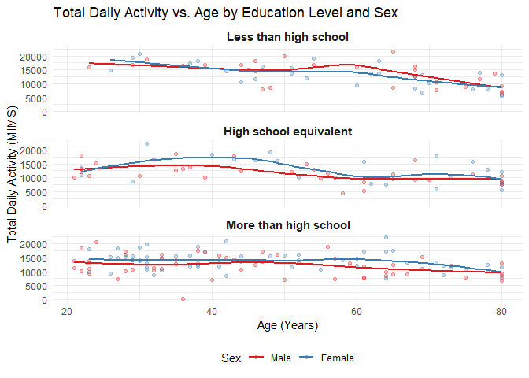
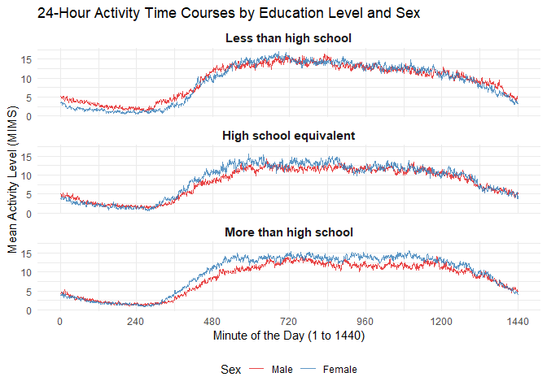
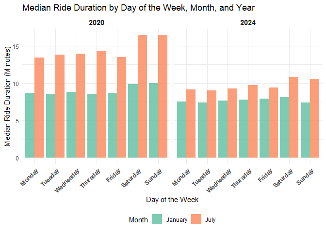
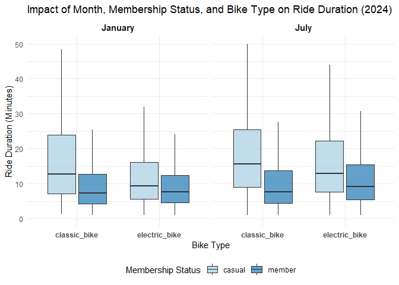

p8105_hw3_al4922
================
2026-10-19

### Problem 1

\##OH questions: 1. Do we get rid of NA’s? 2. guidance on indicating the
extent to which missing data is issue - key points to look at/mention?
3. what does ‘reasonable units’ mean, do the 3 variables have to be
converted to imperial? 4. what is ‘structure’ asking for 5. why is
scatterplot not the best option? 6. When we look at 0-100 for snowfall,
is it by the original or is it by new variables we created 6. when
commenting on plot anything to not miss?

**Step 1: import and clean data**

``` r
data("ny_noaa") #load dataset into environment

noaa_df <- ny_noaa #assign into df, no need to convert missing values to NA since it's 'pre-built' into file

noaa_df = janitor::clean_names(noaa_df)

print(noaa_df, n = 20) #shows that column names converted correctly and that first 16 rows contains no data
```

    ## # A tibble: 2,595,176 × 7
    ##    id          date        prcp  snow  snwd tmax  tmin 
    ##    <chr>       <date>     <int> <int> <int> <chr> <chr>
    ##  1 US1NYAB0001 2007-11-01    NA    NA    NA <NA>  <NA> 
    ##  2 US1NYAB0001 2007-11-02    NA    NA    NA <NA>  <NA> 
    ##  3 US1NYAB0001 2007-11-03    NA    NA    NA <NA>  <NA> 
    ##  4 US1NYAB0001 2007-11-04    NA    NA    NA <NA>  <NA> 
    ##  5 US1NYAB0001 2007-11-05    NA    NA    NA <NA>  <NA> 
    ##  6 US1NYAB0001 2007-11-06    NA    NA    NA <NA>  <NA> 
    ##  7 US1NYAB0001 2007-11-07    NA    NA    NA <NA>  <NA> 
    ##  8 US1NYAB0001 2007-11-08    NA    NA    NA <NA>  <NA> 
    ##  9 US1NYAB0001 2007-11-09    NA    NA    NA <NA>  <NA> 
    ## 10 US1NYAB0001 2007-11-10    NA    NA    NA <NA>  <NA> 
    ## 11 US1NYAB0001 2007-11-11    NA    NA    NA <NA>  <NA> 
    ## 12 US1NYAB0001 2007-11-12    NA    NA    NA <NA>  <NA> 
    ## 13 US1NYAB0001 2007-11-13    NA    NA    NA <NA>  <NA> 
    ## 14 US1NYAB0001 2007-11-14    NA    NA    NA <NA>  <NA> 
    ## 15 US1NYAB0001 2007-11-15    NA    NA    NA <NA>  <NA> 
    ## 16 US1NYAB0001 2007-11-16    NA    NA    NA <NA>  <NA> 
    ## 17 US1NYAB0001 2007-11-17     3     3     0 <NA>  <NA> 
    ## 18 US1NYAB0001 2007-11-18     0     0    NA <NA>  <NA> 
    ## 19 US1NYAB0001 2007-11-19     0     0     0 <NA>  <NA> 
    ## 20 US1NYAB0001 2007-11-20    25     0     0 <NA>  <NA> 
    ## # ℹ 2,595,156 more rows

**Preliminary Data description:** This dataset contains 7 variables
named: “id”, “date”, “prcp”, “snow”, “snwd”, “tmax” and “tmin”. In these
7 columns, it contains 2595176 observations with its weather station ID
(“id”), date of observation (“date”), precipitation to tenths of mm
(“prcp”), snowfall to mm (“snow”), snow depth to mm (“snwd”), and min
max temperature to tenths of Celsius (“tmin”, “tmax”). The extent to
which missing data is an issue depends on what questions you want to
answer as well as if the data missing can be inferred from other data in
the same row. For example if you want to ask about precipitation levels
for a certain time period in which the column ‘prcp’ is empty, then that
would be a major issue. However, variables like ‘snwd’ could probably be
inferred from ‘snow’. Especially with 2595176 amount of entries even if
you can’t directly calculate ‘snwd’ given ‘snow’, you can just look at
other entries with the same ‘snow’ value and copy it in. These are just
two examples to show that missing data can be a very big issue or a
relatively smaller one depending on your question and specific
circumstances.

**Step 2: Data Manipulation**

``` r
noaa_df <- ny_noaa %>% #This creates separate variables for year, month and day and converts observations of temperature, precipitation and snowfall into more convenient scales (from mm or tenths of mm to cm and from tenths of degrees celsius to degrees celsius) 
  mutate(year = year(date),
         month = month(date),
         day = day(date),
         tmax_1deg = as.numeric(tmax)/10, #1C = 10 tenths of degrees celsius
         tmin_1deg = as.numeric(tmin)/10, #1C = 10 tenths of degrees celsius
         prcp_cm = prcp/100, #1 cm = 100 tenths of mm
         snow_cm = snow/10, #1 cm = 10 mm
         snwd_cm = snwd/10) #1 cm = 10 mm

print(n = 20, noaa_df, width = Inf)#Checked to see that new columns (variables) made correctly. 
```

    ## # A tibble: 2,595,176 × 15
    ##    id          date        prcp  snow  snwd tmax  tmin   year month   day
    ##    <chr>       <date>     <int> <int> <int> <chr> <chr> <dbl> <dbl> <int>
    ##  1 US1NYAB0001 2007-11-01    NA    NA    NA <NA>  <NA>   2007    11     1
    ##  2 US1NYAB0001 2007-11-02    NA    NA    NA <NA>  <NA>   2007    11     2
    ##  3 US1NYAB0001 2007-11-03    NA    NA    NA <NA>  <NA>   2007    11     3
    ##  4 US1NYAB0001 2007-11-04    NA    NA    NA <NA>  <NA>   2007    11     4
    ##  5 US1NYAB0001 2007-11-05    NA    NA    NA <NA>  <NA>   2007    11     5
    ##  6 US1NYAB0001 2007-11-06    NA    NA    NA <NA>  <NA>   2007    11     6
    ##  7 US1NYAB0001 2007-11-07    NA    NA    NA <NA>  <NA>   2007    11     7
    ##  8 US1NYAB0001 2007-11-08    NA    NA    NA <NA>  <NA>   2007    11     8
    ##  9 US1NYAB0001 2007-11-09    NA    NA    NA <NA>  <NA>   2007    11     9
    ## 10 US1NYAB0001 2007-11-10    NA    NA    NA <NA>  <NA>   2007    11    10
    ## 11 US1NYAB0001 2007-11-11    NA    NA    NA <NA>  <NA>   2007    11    11
    ## 12 US1NYAB0001 2007-11-12    NA    NA    NA <NA>  <NA>   2007    11    12
    ## 13 US1NYAB0001 2007-11-13    NA    NA    NA <NA>  <NA>   2007    11    13
    ## 14 US1NYAB0001 2007-11-14    NA    NA    NA <NA>  <NA>   2007    11    14
    ## 15 US1NYAB0001 2007-11-15    NA    NA    NA <NA>  <NA>   2007    11    15
    ## 16 US1NYAB0001 2007-11-16    NA    NA    NA <NA>  <NA>   2007    11    16
    ## 17 US1NYAB0001 2007-11-17     3     3     0 <NA>  <NA>   2007    11    17
    ## 18 US1NYAB0001 2007-11-18     0     0    NA <NA>  <NA>   2007    11    18
    ## 19 US1NYAB0001 2007-11-19     0     0     0 <NA>  <NA>   2007    11    19
    ## 20 US1NYAB0001 2007-11-20    25     0     0 <NA>  <NA>   2007    11    20
    ##    tmax_1deg tmin_1deg prcp_cm snow_cm snwd_cm
    ##        <dbl>     <dbl>   <dbl>   <dbl>   <dbl>
    ##  1        NA        NA   NA       NA        NA
    ##  2        NA        NA   NA       NA        NA
    ##  3        NA        NA   NA       NA        NA
    ##  4        NA        NA   NA       NA        NA
    ##  5        NA        NA   NA       NA        NA
    ##  6        NA        NA   NA       NA        NA
    ##  7        NA        NA   NA       NA        NA
    ##  8        NA        NA   NA       NA        NA
    ##  9        NA        NA   NA       NA        NA
    ## 10        NA        NA   NA       NA        NA
    ## 11        NA        NA   NA       NA        NA
    ## 12        NA        NA   NA       NA        NA
    ## 13        NA        NA   NA       NA        NA
    ## 14        NA        NA   NA       NA        NA
    ## 15        NA        NA   NA       NA        NA
    ## 16        NA        NA   NA       NA        NA
    ## 17        NA        NA    0.03     0.3       0
    ## 18        NA        NA    0        0        NA
    ## 19        NA        NA    0        0         0
    ## 20        NA        NA    0.25     0         0
    ## # ℹ 2,595,156 more rows

``` r
mc_snow <- noaa_df %>%
  count(snow_cm) %>%
  slice_max(n, n = 1) 

mc_snwd <- noaa_df %>%
  count(snwd_cm) %>%
  slice_max(n, n = 1)# shows results in tibble, most common value for both is '0' and shows up 1597641 times. 

mc_snowil <- mc_snow %>%
  pull(snow_cm)

mc_snwdil <- mc_snwd %>%
  pull(snwd_cm)
```

**Comment:** For snowfall, the most common values for “snow_cm” and
“snwd_cm” are 0 and 0 respectively. This is because in New York where
the weather data is being collected, most days out of the year don’t
snow.

**Step 3: Data Visualization**

``` r
#January plot: 
jan_noaa <- noaa_df %>%
  filter(month == 1) %>%
  group_by(id, year) %>%
  summarize(mean_tmax = mean(tmax_1deg, na.rm = TRUE), .groups = "drop") %>%
  ggplot(aes(x = year, y = mean_tmax, group = id)) +
  geom_line(alpha = 0.2, colour = "steelblue") +
  labs(
    title = "Average Maximum Temperature in Janurary 1981-2010",
    x ="", 
    y = "Avg max Temp (°C)"
    ) +
    theme_minimal()
#July plot: 
july_noaa <- noaa_df %>%
filter(month == 7) %>%
  group_by(id, year) %>%
  summarize(mean_tmax = mean(tmax_1deg, na.rm = TRUE), .groups = "drop") %>%
  ggplot(aes(x = year, y = mean_tmax, group = id)) +
  geom_line(alpha = 0.2, color = "tomato") +
  labs(
    title = "Average Maximum Temperature in July 1981-2010",
    x = "Year",
    y = "Avg max Temp (°C)"
  ) +
  theme_minimal()

# 3. Combine using patchwork operators
jan_noaa / july_noaa
```

    ## Warning: Removed 2905 rows containing missing values or values outside the scale range
    ## (`geom_line()`).

    ## Warning: Removed 3027 rows containing missing values or values outside the scale range
    ## (`geom_line()`).

<!-- -->
There doesn’t seem to be any trend with temperatures within the same
ranges (about -5 to 10C for Jan and 20-30C for July) across the period
observed (1981-2010). However, the stations generally trend up and down
‘together’ and so we see bold thick lines going up and down together.
However, outliers do exist trending at times opposite to the majority
instead of just trending ‘too much’ in the direction of the majority.
Examples include the two large downward spikes between 1980-1990 in the
“July” plot and a few peaks upwards between 2000-2005 in the “January”
plot.

**Step 3 cont: Data Visualization**

``` r
p1 <- noaa_df %>%
  ggplot(aes(x = tmin_1deg, y = tmax_1deg)) +
  geom_bin2d(bins = 60) +
  scale_fill_viridis_c(option = "viridis")
  labs(
    title = "Panel (i): Maximum vs. Minimum Temperature",
    x = "Min Temperature (°C)",
    y = "Max Temperature (°C)",
    fill = "Count"
  ) +
  theme_minimal()
```

    ## NULL

``` r
p2 <- noaa_df %>%
  filter(snow > 0 & snow < 100) %>%
  ggplot(aes(x = factor(year), y = snow)) +
  geom_boxplot(fill = "skyblue", color = "darkblue", alpha = 0.6, outlier.alpha = 0.1) +
  labs(
    title = "Panel (ii): Snowfall Distribution by Year (0 < Snowfall < 100)",
    x = "Year",
    y = "Snowfall (mm)"
  ) +
  theme_minimal() +
  theme(
    axis.text.x = element_text(angle = 45, hjust = 1)
  )

# Combine vertically using patchwork
p1 / p2
```

    ## Warning: Removed 1136276 rows containing non-finite outside the scale range
    ## (`stat_bin2d()`).

<!-- --> \### Problem 2
**Step 1: Load, tidy and merge**

``` r
acc_df <- read_csv(file = "./data/nhanes_accel.csv",
                   na = c("", "NA", "."))|>
          janitor::clean_names()
```

    ## Rows: 250 Columns: 1441
    ## ── Column specification ────────────────────────────────────────────────────────
    ## Delimiter: ","
    ## dbl (1441): SEQN, min1, min2, min3, min4, min5, min6, min7, min8, min9, min1...
    ## 
    ## ℹ Use `spec()` to retrieve the full column specification for this data.
    ## ℹ Specify the column types or set `show_col_types = FALSE` to quiet this message.

``` r
demo_df <- read_csv(file = "./data/nhanes_covar.csv",
                    skip = 4,
                    na = c("", "NA", "."))|>
          janitor::clean_names() |>
          drop_na() |>
          filter(age >= 21)
```

    ## Rows: 250 Columns: 5
    ## ── Column specification ────────────────────────────────────────────────────────
    ## Delimiter: ","
    ## dbl (5): SEQN, sex, age, BMI, education
    ## 
    ## ℹ Use `spec()` to retrieve the full column specification for this data.
    ## ℹ Specify the column types or set `show_col_types = FALSE` to quiet this message.

``` r
print(acc_df)
```

    ## # A tibble: 250 × 1,441
    ##     seqn  min1  min2  min3  min4   min5   min6  min7   min8    min9  min10
    ##    <dbl> <dbl> <dbl> <dbl> <dbl>  <dbl>  <dbl> <dbl>  <dbl>   <dbl>  <dbl>
    ##  1 62161 1.11  3.12  1.47  0.938 1.60   0.145  2.10  0.509   1.63   1.20  
    ##  2 62164 1.92  1.67  2.38  0.935 2.59   5.22   2.39  4.90    1.97   3.13  
    ##  3 62169 5.85  5.18  4.76  6.48  6.85   7.24   6.12  7.48    5.47   6.49  
    ##  4 62174 5.42  3.48  3.72  3.81  6.85   4.45   0.561 1.61    0.698  2.72  
    ##  5 62177 6.14  8.06  9.99  6.60  4.57   2.78   7.10  7.25   10.1    7.49  
    ##  6 62178 0.167 0.429 0.131 1.20  0.0796 0.0487 0.106 0.0653  0.0564 0.0639
    ##  7 62180 0.039 0     0     0     0.369  0.265  0.506 0.638   0      0.011 
    ##  8 62184 1.55  2.81  3.86  4.76  6.10   7.61   4.74  6.73    5.42   4.24  
    ##  9 62186 3.08  2.54  2.63  2.12  1.14   1.68   2.84  2.72    2.13   2.18  
    ## 10 62189 2.81  0.195 0.163 0     0.144  0.180  0.870 0.214   0      0     
    ## # ℹ 240 more rows
    ## # ℹ 1,430 more variables: min11 <dbl>, min12 <dbl>, min13 <dbl>, min14 <dbl>,
    ## #   min15 <dbl>, min16 <dbl>, min17 <dbl>, min18 <dbl>, min19 <dbl>,
    ## #   min20 <dbl>, min21 <dbl>, min22 <dbl>, min23 <dbl>, min24 <dbl>,
    ## #   min25 <dbl>, min26 <dbl>, min27 <dbl>, min28 <dbl>, min29 <dbl>,
    ## #   min30 <dbl>, min31 <dbl>, min32 <dbl>, min33 <dbl>, min34 <dbl>,
    ## #   min35 <dbl>, min36 <dbl>, min37 <dbl>, min38 <dbl>, min39 <dbl>, …

``` r
print(demo_df) #this is to check that the skip = 4, na conversions, drop_na, age < 21 dropped, clean_names all worked
```

    ## # A tibble: 228 × 5
    ##     seqn   sex   age   bmi education
    ##    <dbl> <dbl> <dbl> <dbl>     <dbl>
    ##  1 62161     1    22  23.3         2
    ##  2 62164     2    44  23.2         3
    ##  3 62169     1    21  20.1         2
    ##  4 62174     1    80  33.9         3
    ##  5 62177     1    51  20.1         2
    ##  6 62178     1    80  28.5         2
    ##  7 62180     1    35  27.9         3
    ##  8 62184     1    26  22.1         2
    ##  9 62189     2    30  22.4         3
    ## 10 62199     1    57  28           3
    ## # ℹ 218 more rows

``` r
demo_df <- demo_df %>%
  mutate(
    # Convert sex: 1 = male, 2 = female
    sex = factor(sex, 
                 levels = c(1, 2), 
                 labels = c("Male", "Female")),
    
    # Convert education: 1 = less than highschool, 2 = highschool equivalent, 3 = more than highschool
    education = factor(education, 
                       levels = c(1, 2, 3), 
                       labels = c("Less than high school", 
                                  "High school equivalent", 
                                  "More than high school"))
  )

merged_df <- demo_df %>%
  full_join(acc_df, by = "seqn")

print(n = 25, merged_df) #shows properly merged, clean and tidy df ready for manipulation
```

    ## # A tibble: 250 × 1,445
    ##     seqn sex      age   bmi education         min1    min2    min3   min4   min5
    ##    <dbl> <fct>  <dbl> <dbl> <fct>            <dbl>   <dbl>   <dbl>  <dbl>  <dbl>
    ##  1 62161 Male      22  23.3 High school e…  1.11    3.12    1.47   0.938  1.60  
    ##  2 62164 Female    44  23.2 More than hig…  1.92    1.67    2.38   0.935  2.59  
    ##  3 62169 Male      21  20.1 High school e…  5.85    5.18    4.76   6.48   6.85  
    ##  4 62174 Male      80  33.9 More than hig…  5.42    3.48    3.72   3.81   6.85  
    ##  5 62177 Male      51  20.1 High school e…  6.14    8.06    9.99   6.60   4.57  
    ##  6 62178 Male      80  28.5 High school e…  0.167   0.429   0.131  1.20   0.0796
    ##  7 62180 Male      35  27.9 More than hig…  0.039   0       0      0      0.369 
    ##  8 62184 Male      26  22.1 High school e…  1.55    2.81    3.86   4.76   6.10  
    ##  9 62189 Female    30  22.4 More than hig…  2.81    0.195   0.163  0      0.144 
    ## 10 62199 Male      57  28   More than hig…  0.031   0.0359  0.0387 0.079  0.109 
    ## 11 62202 Male      36  24.7 Less than hig…  3.68    3.28    4.37   4.03   1.63  
    ## 12 62205 Male      28  28.9 More than hig…  6.81    8.65    6.77   9.52   7.78  
    ## 13 62206 Female    35  29.1 More than hig…  1.27    2.22    0.845  1.02   0.414 
    ## 14 62208 Male      38  22.2 More than hig…  6.10    8.70   10.0    7.17   5.15  
    ## 15 62209 Female    62  26   Less than hig…  2.59    1.43    4.68   1.82   3.23  
    ## 16 62214 Female    22  23.8 High school e… 11.7    11.7     8.44   6.45   8.75  
    ## 17 62215 Female    65  26.7 More than hig…  3.82    5.90    7.12   4.50   4.14  
    ## 18 62217 Female    77  30.6 Less than hig…  1.40    1.42    0.968  0.964  0.120 
    ## 19 62218 Female    38  45.4 More than hig…  0.261   4.44    3.52   2.78   1.53  
    ## 20 62220 Female    31  40.4 More than hig…  0.131   0.471   0.0314 2.74   0.400 
    ## 21 62222 Male      32  25   More than hig…  4.51    5.51    5.86   7.44   8.62  
    ## 22 62223 Male      54  20.5 High school e…  5.10    1.65    4.45   0.971  7.05  
    ## 23 62224 Female    29  27.2 Less than hig…  0.0963  0.114   0.0869 0.0867 0.282 
    ## 24 62226 Male      80  28.4 More than hig…  0.0827  0.0387  0.0616 0.537  1.60  
    ## 25 62228 Male      50  43.4 More than hig…  0.948   1.33    0.327  1.14   0.319 
    ## # ℹ 225 more rows
    ## # ℹ 1,435 more variables: min6 <dbl>, min7 <dbl>, min8 <dbl>, min9 <dbl>,
    ## #   min10 <dbl>, min11 <dbl>, min12 <dbl>, min13 <dbl>, min14 <dbl>,
    ## #   min15 <dbl>, min16 <dbl>, min17 <dbl>, min18 <dbl>, min19 <dbl>,
    ## #   min20 <dbl>, min21 <dbl>, min22 <dbl>, min23 <dbl>, min24 <dbl>,
    ## #   min25 <dbl>, min26 <dbl>, min27 <dbl>, min28 <dbl>, min29 <dbl>,
    ## #   min30 <dbl>, min31 <dbl>, min32 <dbl>, min33 <dbl>, min34 <dbl>, …

**Step 2: Table Creation**

``` r
edu_by_sex <- merged_df %>%
  drop_na(sex, education) %>%
  count(education, sex) %>%
  pivot_wider(names_from = sex, values_from = n, values_fill = 0)

print(edu_by_sex) #Checks that table works
```

    ## # A tibble: 3 × 3
    ##   education               Male Female
    ##   <fct>                  <int>  <int>
    ## 1 Less than high school     27     28
    ## 2 High school equivalent    35     23
    ## 3 More than high school     56     59

``` r
knitr::kable(
  edu_by_sex,
  col.names = c("Education Category", "Male", "Female"),
  caption = "Table 1. Number of Men and Women Across Education Categories"
)
```

| Education Category     | Male | Female |
|:-----------------------|-----:|-------:|
| Less than high school  |   27 |     28 |
| High school equivalent |   35 |     23 |
| More than high school  |   56 |     59 |

Table 1. Number of Men and Women Across Education Categories

``` r
male1 <- edu_by_sex %>%
  filter(education == 'Less than high school') %>%
  pull(Male)

male2 <- edu_by_sex %>%
  filter(education == 'High school equivalent') %>%
  pull(Male)

male3 <- edu_by_sex %>%
  filter(education == 'More than high school') %>%
  pull(Male)

female1 <- edu_by_sex %>%
  filter(education == 'Less than high school') %>%
  pull(Female)

female2 <- edu_by_sex %>%
  filter(education == 'High school equivalent') %>%
  pull(Female)

female3  <- edu_by_sex %>%
  filter(education == 'More than high school') %>%
  pull(Female)
```

**Comment on Male and Female by Education Cat Table:** From the table,
we see that males and females with less than high school education are
27 and 28 respectively. males and females with high school equivalent
education are 35 and 23 respectively and finally, males and females with
higher than highs school education are 56 and 59 respectively. The
dataset is mostly balanced between Male and Female with the greatest
difference being 12 between Male and Female who received high school
equivalent education. **Step 3: Visualization**

``` r
#Create the visualization for age distributions
age_dist_plot <- merged_df %>%
  drop_na(age, sex, education) %>%
  ggplot(aes(x = education, y = age, fill = sex)) +
  geom_boxplot(alpha = 0.7, outlier.alpha = 0.3) +
  labs(
    title = "Age Distribution by Education Category and Sex",
    x = "Education Category",
    y = "Age (Years)",
    fill = "Sex"
  ) +
  theme_minimal() +
  theme(
    axis.text.x = element_text(angle = 20, hjust = 1), 
    legend.position = "bottom"
  ) +
  scale_fill_brewer(palette = "Set2")

# Print the plot
print(age_dist_plot)
```

<!-- -->
**Comment on age distribution by education cat and sex plot:** The mean
ages for each education category between the 2 sexes are quite similar.
With the ‘Less than high school’ category having a mean female age of
57.5 and a mean male age of 57.2. Then in the ‘High school equivalent’
category, the mean female age is 57.4 while the mean male age is 49.4.
Finally in the ‘More than Highschool’ category, the mean female age is
45.7 while the mean male age is 46.6. The range of ages goes from about
30 upwards to about 75 across education categories and sex. There is
also a downwards trend in mean age observable in both sexes from the
‘less than highschool’ category until the youngest category of ‘more
than highschool’. \#comment: inline code changed since wanted to try
different ways, even though second inline code harder to read in rmd, it
is faster to do. **Step 3 cont.: Visualization**

``` r
#Visualization of total activity over the day

# 1. Aggregate across minute columns to create a total activity variable for each participant
# starts_with("min") targets all minute-by-minute activity columns automatically
activity_summary <- merged_df %>%
  mutate(
    total_activity = rowSums(select(., starts_with("min")), na.rm = TRUE)
  )

# 2. Create the plot comparing men to women, with age on the x-axis, 
# total activity on the y-axis, and faceted by education level
activity_summary %>%
  drop_na(age, total_activity, sex, education) %>%
  ggplot(aes(x = age, y = total_activity, color = sex, fill = sex)) +
  geom_point(alpha = 0.3, size = 1.3) + # Scatter points with slight transparency
  geom_smooth(method = "loess", se = FALSE, linewidth = 1) + # Smooth trend lines with confidence intervals
  facet_wrap(~ education, ncol = 1) + # Separate panels stacked vertically for each education category
  labs(
    title = "Total Daily Activity vs. Age by Education Level and Sex",
    x = "Age (Years)",
    y = "Total Daily Activity (MIMS)",
    color = "Sex",
    fill = "Sex"
  ) +
  theme_minimal() +
  theme(
    legend.position = "bottom",
    strip.text = element_text(face = "bold", size = 11)
  ) +
  scale_color_brewer(palette = "Set1") +
  scale_fill_brewer(palette = "Set1")
```

    ## `geom_smooth()` using formula = 'y ~ x'

<!-- -->
***Total Daily Activity Comment*** All three graphs generally follow a
slight downwards trend as age increases but stay mostly stable. In the
“less than highschool’ category, men generally had higher levels of
Total Daily Activity when the opposite is true for the other two plots
for the other education categories.

``` r
# Visualization of activity of day but 24-hour time course

# 1. Pivot minute-level accelerometer columns to long format while keeping demographic variables
time_course_long <- merged_df %>%
  pivot_longer(
    cols = starts_with("min"), 
    names_to = "minute_col", 
    values_to = "activity"
  ) %>%
  mutate(
    # Extract the numeric minute value from column names like "min1" -> 1
    minute = readr::parse_number(minute_col)
  )

# 2. Calculate the mean activity for each combination of education, sex, and minute
plot_data <- time_course_long %>%
  drop_na(education, sex, minute, activity) %>%
  group_by(education, sex, minute) %>%
  summarize(mean_activity = mean(activity, na.rm = TRUE), .groups = "drop")

# 3. Create the three-panel time-course plot using minute on the x-axis
plot_data %>%
  ggplot(aes(x = minute, y = mean_activity, color = sex, group = sex)) +
  geom_line(linewidth = 0.6, alpha = 0.8) +
  facet_wrap(~ education, ncol = 1) + # Creates three stacked panels for each education tier[cite: 3]
  labs(
    title = "24-Hour Activity Time Courses by Education Level and Sex",
    x = "Minute of the Day (1 to 1440)",
    y = "Mean Activity Level (MIMS)",
    color = "Sex"
  ) +
  theme_minimal() +
  theme(
    strip.text = element_text(face = "bold", size = 11),
    legend.position = "bottom"
  ) +
  scale_color_brewer(palette = "Set1") +
  scale_x_continuous(breaks = seq(0, 1440, by = 240)) # Adds tick marks every 4 hours (240 minutes)
```

<!-- -->

***Comments on 24-Hour activity plot:*** From the general trend, we can
see the low mean activity level from minutes 0-360 when people are
generally asleep across sex and education level. Then activity makes a
sharp rise until about 480 which corresponds to 8AM when people get up
to start their daily activities. Finally we see across all three
educational levels that there is a daytime plateau which starts to trend
downwards at around 1200 minutes which is about 10pm when people begin
to go to bed.

In terms of sex differences, in the “more than highschool” plot we see
that females average slightly higher activity level throughout the day
compared to the other two in which the male and female lines basically
overlap. This suggests subtle differences in daytime activity
distribution or volume among higher-educated cohorts.

### Problem 3

***Step 1: Data import, clean and tidy***

``` r
# 1. Import and clean 
jan_2020_df <- read_csv(file = "./data/Jan 2020 Citi.csv",
                        na = c("", "NA", ".")) |>
  janitor::clean_names() |>
  mutate(year = "2020", month = "January")
```

    ## Rows: 12420 Columns: 7
    ## ── Column specification ────────────────────────────────────────────────────────
    ## Delimiter: ","
    ## chr (6): ride_id, rideable_type, weekdays, start_station_name, end_station_n...
    ## dbl (1): duration
    ## 
    ## ℹ Use `spec()` to retrieve the full column specification for this data.
    ## ℹ Specify the column types or set `show_col_types = FALSE` to quiet this message.

``` r
july_2020_df <- read_csv(file = "./data/July 2020 Citi.csv",
                         na = c("", "NA", ".")) |>
  janitor::clean_names() |>
  mutate(year = "2020", month = "July")
```

    ## Rows: 21048 Columns: 7
    ## ── Column specification ────────────────────────────────────────────────────────
    ## Delimiter: ","
    ## chr (6): ride_id, rideable_type, weekdays, start_station_name, end_station_n...
    ## dbl (1): duration
    ## 
    ## ℹ Use `spec()` to retrieve the full column specification for this data.
    ## ℹ Specify the column types or set `show_col_types = FALSE` to quiet this message.

``` r
jan_2024_df <- read_csv(file = "./data/Jan 2024 Citi.csv",
                        na = c("", "NA", ".")) |>
  janitor::clean_names() |>
  mutate(year = "2024", month = "January")
```

    ## Rows: 18861 Columns: 7
    ## ── Column specification ────────────────────────────────────────────────────────
    ## Delimiter: ","
    ## chr (6): ride_id, rideable_type, weekdays, start_station_name, end_station_n...
    ## dbl (1): duration
    ## 
    ## ℹ Use `spec()` to retrieve the full column specification for this data.
    ## ℹ Specify the column types or set `show_col_types = FALSE` to quiet this message.

``` r
july_2024_df <- read_csv(file = "./data/July 2024 Citi.csv",
                         na = c("", "NA", ".")) |>
  janitor::clean_names() |>
  mutate(year = "2024", month = "July")
```

    ## Rows: 47156 Columns: 7
    ## ── Column specification ────────────────────────────────────────────────────────
    ## Delimiter: ","
    ## chr (6): ride_id, rideable_type, weekdays, start_station_name, end_station_n...
    ## dbl (1): duration
    ## 
    ## ℹ Use `spec()` to retrieve the full column specification for this data.
    ## ℹ Specify the column types or set `show_col_types = FALSE` to quiet this message.

``` r
# 2. Check the imports
print(jan_2020_df)
```

    ## # A tibble: 12,420 × 9
    ##    ride_id   rideable_type weekdays duration start_station_name end_station_name
    ##    <chr>     <chr>         <chr>       <dbl> <chr>              <chr>           
    ##  1 4BE06CB3… classic_bike  Tuesday     15.3  Columbus Ave & W … E 53 St & Madis…
    ##  2 26886E03… classic_bike  Wednesd…     5.31 2 Ave & E 96 St    1 Ave & E 110 St
    ##  3 24DC5606… classic_bike  Friday       9.69 Columbia St & Riv… Grand St & Eliz…
    ##  4 EEDC1053… classic_bike  Sunday       7.00 W 84 St & Columbu… Columbus Ave & …
    ##  5 2CD4BD4C… classic_bike  Friday       2.85 Forsyth St & Broo… Suffolk St & St…
    ##  6 E18682F9… classic_bike  Sunday      25.5  Allen St & Hester… Atlantic Ave & …
    ##  7 B9B2E896… classic_bike  Sunday       3.65 Lafayette St & Je… Washington Pl &…
    ##  8 DEF8F504… classic_bike  Sunday      38.3  28 Ave & 44 St     Broadway & Kosc…
    ##  9 17D44DA9… classic_bike  Thursday    38.5  Barrow St & Hudso… Emerson Pl & My…
    ## 10 0FD113A3… classic_bike  Tuesday      6.52 Carlton Ave & Par… Emerson Pl & My…
    ## # ℹ 12,410 more rows
    ## # ℹ 3 more variables: member_casual <chr>, year <chr>, month <chr>

``` r
print(july_2020_df)
```

    ## # A tibble: 21,048 × 9
    ##    ride_id   rideable_type weekdays duration start_station_name end_station_name
    ##    <chr>     <chr>         <chr>       <dbl> <chr>              <chr>           
    ##  1 A7503F19… classic_bike  Sunday       9.86 Franklin Ave & Em… Grand Army Plaz…
    ##  2 B47EBE0E… classic_bike  Monday       8.29 E 33 St & 1 Ave    E 33 St & 5 Ave 
    ##  3 8146F6C6… classic_bike  Wednesd…     5.39 George St & Wilso… Willoughby Ave …
    ##  4 D49560E3… classic_bike  Saturday    19.2  St. Nicholas Ave … Willis Ave & E …
    ##  5 87687AAE… classic_bike  Tuesday     26.4  Front St & Jay St  Grand St & Eliz…
    ##  6 E30DFCD9… classic_bike  Sunday      51.9  Clinton St & Jora… Myrtle Ave & Li…
    ##  7 0C53CC46… classic_bike  Tuesday     15.7  Vernon Blvd & 50 … Vernon Blvd & 3…
    ##  8 34B02685… classic_bike  Wednesd…     8.39 11 Ave & W 59 St   Columbus Ave & …
    ##  9 15377067… classic_bike  Tuesday      5.56 Fulton St & Broad… St James Pl & O…
    ## 10 A834D6A0… classic_bike  Wednesd…    14.3  W 45 St & 6 Ave    W 30 St & 10 Ave
    ## # ℹ 21,038 more rows
    ## # ℹ 3 more variables: member_casual <chr>, year <chr>, month <chr>

``` r
print(jan_2024_df)
```

    ## # A tibble: 18,861 × 9
    ##    ride_id   rideable_type weekdays duration start_station_name end_station_name
    ##    <chr>     <chr>         <chr>       <dbl> <chr>              <chr>           
    ##  1 644A0105… electric_bike Wednesd…    16.5  Lafayette St & Je… W 50 St & 9 Ave 
    ##  2 A5A8C0AD… electric_bike Wednesd…     6.29 Clinton St & Till… Duffield St & W…
    ##  3 B392CE34… electric_bike Tuesday      6.12 West End Ave & W … W 116 St & Broa…
    ##  4 33756EDC… electric_bike Wednesd…    10.9  Grand St & Elizab… Front St & Jay …
    ##  5 29D9AF64… electric_bike Thursday     8.42 12 Ave & W 40 St   Washington St &…
    ##  6 C7E61191… electric_bike Sunday      18.5  7 Ave & Central P… 44 Dr & Jackson…
    ##  7 947A4F86… electric_bike Sunday       3.45 Edgecombe Ave & W… Adam Clayton Po…
    ##  8 0AD92E71… electric_bike Monday      14.9  11 Ave & W 59 St   1 Ave & E 30 St 
    ##  9 CE2C128D… electric_bike Friday       9.55 Allen St & Stanto… Christopher St …
    ## 10 DAAB66B1… electric_bike Sunday       4.87 6 Ave & W 33 St    W 34 St & Hudso…
    ## # ℹ 18,851 more rows
    ## # ℹ 3 more variables: member_casual <chr>, year <chr>, month <chr>

``` r
print(july_2024_df)
```

    ## # A tibble: 47,156 × 9
    ##    ride_id   rideable_type weekdays duration start_station_name end_station_name
    ##    <chr>     <chr>         <chr>       <dbl> <chr>              <chr>           
    ##  1 86AE148E… classic_bike  Sunday      19.7  Picnic Point       Yankee Ferry Te…
    ##  2 FCF07A30… electric_bike Thursday     7.68 W 54 St & 9 Ave    W 42 St & 8 Ave 
    ##  3 D8397E84… classic_bike  Thursday    24.5  12 Ave & W 40 St   W 84 St & Amste…
    ##  4 E575690C… electric_bike Tuesday      3.53 Grand St & Haveme… S 4 St & Rodney…
    ##  5 184AABED… electric_bike Wednesd…    24.1  Broadway & Kent A… Henry St & Degr…
    ##  6 ACA61A92… classic_bike  Saturday     7.83 E 1 St & 1 Ave     Mercer St & Spr…
    ##  7 C48F946C… classic_bike  Sunday       4.85 Lenox Ave & W 117… Frederick Dougl…
    ##  8 F3072F6E… classic_bike  Saturday     4.33 W 53 St & 10 Ave   West End Ave & …
    ##  9 8A283594… electric_bike Thursday    12.6  W 10 St & Washing… Stanton St & Ch…
    ## 10 EFFCEE4C… electric_bike Friday      10.6  W 55 St & 6 Ave    Broadway & W 41…
    ## # ℹ 47,146 more rows
    ## # ℹ 3 more variables: member_casual <chr>, year <chr>, month <chr>

``` r
# 3. Join them all into one master dataset 
citibike_combined_df <- bind_rows(
  jan_2020_df,
  july_2020_df,
  jan_2024_df,
  july_2024_df
)

# Check the final combined dataset
glimpse(citibike_combined_df[13000, ]) #Merged dataset clean and tidy, also nothing wrong with mutating in month and year
```

    ## Rows: 1
    ## Columns: 9
    ## $ ride_id            <chr> "55AE7FF35244671D"
    ## $ rideable_type      <chr> "classic_bike"
    ## $ weekdays           <chr> "Thursday"
    ## $ duration           <dbl> 24.71835
    ## $ start_station_name <chr> "West Thames St"
    ## $ end_station_name   <chr> "1 Ave & E 30 St"
    ## $ member_casual      <chr> "member"
    ## $ year               <chr> "2020"
    ## $ month              <chr> "July"

***Data Description*** The resulting dataset contains
`r`ncol(citibike_combined_df)\` columns with the variables: ride_id,
rideable_type, weekdays, duration, start_station, end_station,
member_casual, month and year. There are 99485 total rows in the dataset
with each row representing a ride. The year and month columns were added
in for later use down the line and all rows and columns (which are same
across 4 files) kept in ‘merge’.

***Step 2: Make Table 1***

``` r
# 1. Aggregate and pivot the data to show rides by year, month, and rider type
rides_by_time_user <- citibike_combined_df %>%
  drop_na(year, month, member_casual) %>%
  count(year, month, member_casual) %>%
  pivot_wider(
    names_from = member_casual, 
    values_from = n, 
    values_fill = 0
  )

# 2. Check the tibble structure in the console
print(rides_by_time_user)
```

    ## # A tibble: 4 × 4
    ##   year  month   casual member
    ##   <chr> <chr>    <int>  <int>
    ## 1 2020  January    984  11436
    ## 2 2020  July      5637  15411
    ## 3 2024  January   2108  16753
    ## 4 2024  July     10894  36262

``` r
# 3. Create a reader-friendly formatted table using knitr::kable
knitr::kable(
  rides_by_time_user,
  col.names = c("Year", "Month", "Casual", "Member"),
  caption = "Table 1. Total Number of Citi Bike Rides by Year, Month, and Rider Type"
)
```

| Year | Month   | Casual | Member |
|:-----|:--------|-------:|-------:|
| 2020 | January |    984 |  11436 |
| 2020 | July    |   5637 |  15411 |
| 2024 | January |   2108 |  16753 |
| 2024 | July    |  10894 |  36262 |

Table 1. Total Number of Citi Bike Rides by Year, Month, and Rider Type

***Table 1 comments:*** In the table, July 2024 had the highest number
of causal riders as well as member rides (10894 and 36262,
respectively). The member rides keeps increasing over time with the
largest increase happening between 2024 Jan and July (19509 increase in
rides). The causal rides generally increase as well, however, there is a
dip from July 2020 to January 2024 (5637 to 2108).

***Step 2: Make Table 2***

``` r
# 1. Calculate the top 5 starting stations for July 2024
top_start_stations_24 <- citibike_combined_df %>%
  filter(year == 2024, month == "July") %>%
  drop_na(start_station_name) %>%
  count(start_station_name, sort = TRUE) %>%
  slice_head(n = 5)

# 2. Check the table in the console
print(top_start_stations_24)
```

    ## # A tibble: 5 × 2
    ##   start_station_name           n
    ##   <chr>                    <int>
    ## 1 Pier 61 at Chelsea Piers   163
    ## 2 University Pl & E 14 St    155
    ## 3 W 21 St & 6 Ave            152
    ## 4 West St & Chambers St      150
    ## 5 W 31 St & 7 Ave            146

``` r
# 3. Create a publication-ready formatted table using knitr::kable
knitr::kable(
  top_start_stations_24,
  col.names = c("Starting Station Name", "Number of Rides"),
  caption = "Table 2. Top 5 Most Popular Starting Stations for July 2024"
)
```

| Starting Station Name    | Number of Rides |
|:-------------------------|----------------:|
| Pier 61 at Chelsea Piers |             163 |
| University Pl & E 14 St  |             155 |
| W 21 St & 6 Ave          |             152 |
| West St & Chambers St    |             150 |
| W 31 St & 7 Ave          |             146 |

Table 2. Top 5 Most Popular Starting Stations for July 2024

***Step 3: Data Visualization 1***

``` r
#Calculate median ride duration across year, month, and day of the week
median_duration_df <- citibike_combined_df %>%
  drop_na(year, month, weekdays, duration) %>%
  group_by(year, month, weekdays) %>%
  summarize(
    median_duration = median(duration, na.rm = TRUE),
    .groups = "drop"
  ) %>%
  # Optional: Reorder days of the week chronologically (Monday - Sunday)
  mutate(
    weekdays = factor(weekdays, levels = c("Monday", "Tuesday", "Wednesday", "Thursday", "Friday", "Saturday", "Sunday"))
  )

# Check the summarized table
print(median_duration_df)
```

    ## # A tibble: 28 × 4
    ##    year  month   weekdays  median_duration
    ##    <chr> <chr>   <fct>               <dbl>
    ##  1 2020  January Friday               8.64
    ##  2 2020  January Monday               8.66
    ##  3 2020  January Saturday             9.88
    ##  4 2020  January Sunday               9.97
    ##  5 2020  January Thursday             8.50
    ##  6 2020  January Tuesday              8.57
    ##  7 2020  January Wednesday            8.80
    ##  8 2020  July    Friday              13.5 
    ##  9 2020  July    Monday              13.4 
    ## 10 2020  July    Saturday            16.5 
    ## # ℹ 18 more rows

``` r
# Create the comparison plot
median_duration_df %>%
  ggplot(aes(x = weekdays, y = median_duration, fill = month)) +
  geom_col(position = "dodge", alpha = 0.85) + # Side-by-side bars comparing months within days
  facet_wrap(~ year, ncol = 2) +             # Separate panels for each year (2020 vs 2024)
  labs(
    title = "Median Ride Duration by Day of the Week, Month, and Year",
    x = "Day of the Week",
    y = "Median Ride Duration (Minutes)", #Duration assumed to be in minutes according to google search
    fill = "Month"
  ) +
  theme_minimal() +
  theme(
    axis.text.x = element_text(angle = 45, hjust = 1, face = "bold"),
    strip.text = element_text(face = "bold", size = 11),
    legend.position = "bottom"
  ) +
  scale_fill_brewer(palette = "Set2")
```

<!-- -->
***Plot 1 observations:*** We see that across both plots, median ride
duration, that point at which 50% of ride duration is lower or higher,
is longer during July compared to January. This makes sense because
people tend to be outside more and ride bikes more during the summer
months when the weather is nice. But while the median duration for
January hasn’t changed much across the two years, median duration for
July 2020 were much longer than duration for July 2024. This is probably
because bike riding was a socially distanced activity you could do
outside during the pandemic. But in general, people rode the citibikes
at longer median durations in 2020. Over the weekdays the median
duration is relatively stable but rising for the weekends. This change
between weekdays and weekends is more dramatic in 2020 than 2024 which
seems to speak to the limited activity choices in that year.

***Step 4: Data Visualization 2:***

``` r
# Filter and prepare the 2024 data
duration_2024_df <- citibike_combined_df %>%
  filter(year == 2024) %>%
  drop_na(month, member_casual, rideable_type, duration) 

# Check the prepared subset
print(duration_2024_df)
```

    ## # A tibble: 66,017 × 9
    ##    ride_id   rideable_type weekdays duration start_station_name end_station_name
    ##    <chr>     <chr>         <chr>       <dbl> <chr>              <chr>           
    ##  1 644A0105… electric_bike Wednesd…    16.5  Lafayette St & Je… W 50 St & 9 Ave 
    ##  2 A5A8C0AD… electric_bike Wednesd…     6.29 Clinton St & Till… Duffield St & W…
    ##  3 B392CE34… electric_bike Tuesday      6.12 West End Ave & W … W 116 St & Broa…
    ##  4 33756EDC… electric_bike Wednesd…    10.9  Grand St & Elizab… Front St & Jay …
    ##  5 29D9AF64… electric_bike Thursday     8.42 12 Ave & W 40 St   Washington St &…
    ##  6 C7E61191… electric_bike Sunday      18.5  7 Ave & Central P… 44 Dr & Jackson…
    ##  7 947A4F86… electric_bike Sunday       3.45 Edgecombe Ave & W… Adam Clayton Po…
    ##  8 0AD92E71… electric_bike Monday      14.9  11 Ave & W 59 St   1 Ave & E 30 St 
    ##  9 CE2C128D… electric_bike Friday       9.55 Allen St & Stanto… Christopher St …
    ## 10 DAAB66B1… electric_bike Sunday       4.87 6 Ave & W 33 St    W 34 St & Hudso…
    ## # ℹ 66,007 more rows
    ## # ℹ 3 more variables: member_casual <chr>, year <chr>, month <chr>

``` r
# Create the multi-panel distribution plot
duration_2024_df %>%
  ggplot(aes(x = rideable_type, y = duration, fill = member_casual)) +
  geom_boxplot(alpha = 0.7, outlier.shape = NA) + 
  facet_wrap(~ month, ncol = 2) +               
  labs(
    title = "Impact of Month, Membership Status, and Bike Type on Ride Duration (2024)",
    x = "Bike Type",
    y = "Ride Duration (Minutes)", #Duration assumed to be in minutes according to google search
    fill = "Membership Status"
  ) +
  theme_minimal() +
  theme(
    strip.text = element_text(face = "bold", size = 11),
    legend.position = "bottom",
    axis.text.x = element_text(face = "bold")
  ) +
  scale_fill_brewer(palette = "Paired") +
  coord_cartesian(ylim = c(0, 50)) 
```

<!-- --> ***Plot 2
Comments:*** We see that while rides from members stay relatively stable
across the months and bikes (with slight increase on electric bike in
July), causal rides change by bike type and months. For casual rides,
there is a increase in ride duration from January to July and from
electric bike to classic bike. The change in weather across the months
has been discussed previously, but here we also see a change between
classic and electric bike probably due to price differences.

For non-members, there is a unlock fee for classic bikes and then you
get the first 30 minutes free but for an electric bike you have to pay
for every minute. That’s why it’s more worth-it to ride your full 30
min. for the classic bike and stay on the electric bike for as short a
time as possible for casual riders. This explains the decrease in
duration from classic boke to electric bike for casual riders across
both months.

Finally between members, casual rides are generally longer than member
rides across bike types and months. This is probably due to pricing as
well with members getting a better deal from increased usage while
casual riders limit usage (to avoid paying unlock fees) but try to get
most of their 30 minutes for casual bikes and only travelling longer
distances with the electric bike (otherwise walking or classic bike are
probably better and cheaper options).
